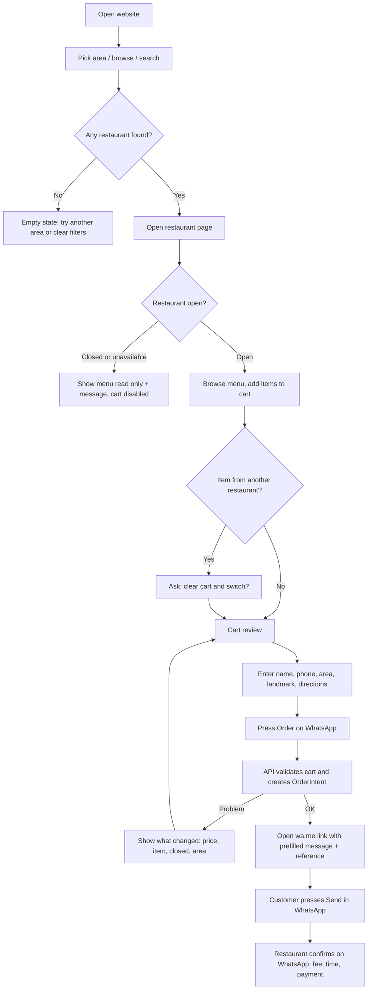
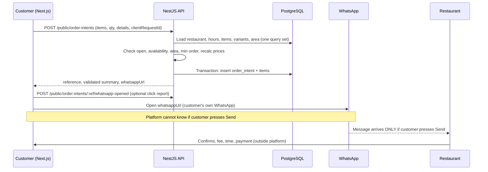
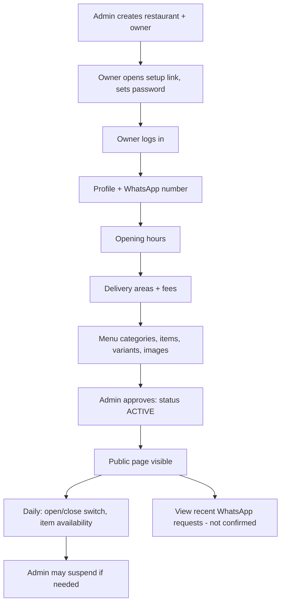

# Dir Food Ordering — System Workflows (Phase A)

Step by step: how the system works and why each table is connected. Same format as Dukaan Pro workflows.

## The 14 workflows

| # | Workflow | Who | Main tables |
|---|---|---|---|
| 1 | Admin onboards a restaurant | Admin, then owner | restaurants, users, restaurant_hours, audit_logs |
| 2 | Login and access check | Owner / Admin | users, restaurants |
| 3 | Approve, suspend, deactivate | Admin | restaurants, audit_logs |
| 4 | Restaurant profile and WhatsApp number | Owner | restaurants |
| 5 | Opening hours and availability | Owner | restaurant_hours, restaurants |
| 6 | Delivery areas and fees | Owner (admin manages areas list) | areas, restaurant_delivery_areas |
| 7 | Menu: categories, items, variants, images | Owner | menu_categories, menu_items, menu_item_variants |
| 8 | Customer discovers restaurants | Guest | restaurants, areas, restaurant_delivery_areas, restaurant_hours |
| 9 | Customer browses menu and builds cart | Guest | menu_categories, menu_items, menu_item_variants |
| 10 | Customer prepares the order | Guest | areas, restaurant_delivery_areas |
| 11 | WhatsApp handoff (create OrderIntent) | Guest | order_intents, order_intent_items |
| 12 | Abandoned handoff, expiry, retention | System job | order_intents |
| 13 | Owner views WhatsApp requests and stats | Owner | order_intents, order_intent_items |
| 14 | Support, complaints, audit | Admin | audit_logs, restaurants |

## Rules behind every workflow

1. **One transaction per action.** An OrderIntent and its items are saved together or not at all.
2. **Private routes are filtered by `restaurant_id` from the session.** Never from the URL or body.
3. **Public is an allowlist.** Public responses use named fields only. No owner phone, no status internals, no customer data.
4. **Prices come from the database.** The browser sends item ids and quantities only. The server recalculates.
5. **History is kept.** Menu items and restaurants are deactivated, not deleted. Order intents keep snapshots.
6. **Double-tap safe.** `client_request_id` is unique; repeating it returns the first intent.
7. **WhatsApp is not an order.** An OrderIntent never means a confirmed order.

## Two security zones

| Zone | Who | Access | Reaches |
|---|---|---|---|
| Public site (`/`, `/r/:slug`) | Anyone | Read, plus create OrderIntent | Active restaurants, their available menu, areas |
| Restaurant dashboard (`/dashboard`) | Owner | Login, `restaurant_id` from session | Own restaurant only |
| Admin (`/admin`) | Platform admin | Login, role check | All restaurants (writes are audit-logged) |

---

## Diagram 1: Customer journey



## Diagram 2: WhatsApp handoff



## Diagram 3: Restaurant operations



---

## Workflow 1: Admin onboards a restaurant

**Who:** Platform admin, then restaurant owner. **Goal:** Create a restaurant and its owner login.

| # | Admin / owner does | System does |
|---|---|---|
| 1 | Admin enters restaurant name, area text, contact phone, WhatsApp number, cuisines. | Normalises phones to `923XXXXXXXXX`. Creates `restaurants` row, status `PENDING`. Creates unique slug from the name (`hotel-al-noor`, `-2` on clash). |
| 2 | Admin enters owner name and login phone. | Creates `users` row (role `RESTAURANT_OWNER`, `restaurant_id` set, no password). Stores hash of one-time setup token + expiry. Shows the link. |
| 3 | (automatic) | Inserts default `restaurant_hours` (e.g. 10:00–23:00 every day) so hours are never empty. |
| 4 | (automatic) | Writes `audit_logs` (`RESTAURANT_CREATED`). |
| 5 | Owner opens link, chooses password. | Saves `password_hash`, clears token. |
| 6 | Owner completes profile, menu, delivery areas (workflows 4–7). | See those workflows. |
| 7 | Admin reviews and approves (workflow 3). | Status becomes `ACTIVE`. Restaurant is public. |

| Table | What happens | Why |
|---|---|---|
| restaurants | Insert | The tenant. Slug and status live here. |
| users | Insert owner | Login identity linked to exactly one restaurant. |
| restaurant_hours | Insert defaults | Open/closed status is calculated from these rows. |
| audit_logs | Insert | Admin actions are traceable. |

**Rules:** login phone unique platform-wide; one owner per restaurant; a `PENDING` restaurant is never public; recovery = admin creates a new setup link.

**Example:** Admin creates "Hotel Al-Noor", Timergara. Owner Gul sets his password, adds 25 items, admin approves. Page `/r/hotel-al-noor` goes live.

---

## Workflow 2: Login and access check

**Who:** Owner / Admin.

| # | User does | System does |
|---|---|---|
| 1 | Types phone and password. | Finds `users` by phone. |
| 2 | (automatic) | Compares with `password_hash`; generic error "phone or password is wrong". Counts failed tries; locks 15 min after 5. |
| 3 | (automatic) | Checks `users.status = ACTIVE`. |
| 4 | (automatic, owner) | Follows `restaurant_id`; reads `restaurants.status`. `SUSPENDED` / `DEACTIVATED` → login allowed but shows "restaurant suspended, contact support"; menu editing blocked. |
| 5 | (automatic) | Issues JWT in httpOnly cookie with `userId`, `role`, `restaurantId`. |
| 6 | Uses dashboard. | Every query adds `WHERE restaurant_id = session.restaurantId`. |

**Tables:** users (authentication), restaurants (what may be opened).
**Rules:** user status and restaurant status are separate checks; the `restaurant_id` is never taken from the request.

---

## Workflow 3: Approve, suspend, deactivate

**Who:** Admin.

| # | Admin does | System does |
|---|---|---|
| 1 | Opens restaurant list, filters `PENDING`. | Reads `restaurants`. |
| 2 | Reviews profile, menu preview, WhatsApp number. | Reads restaurant, items. Warns if no items, no WhatsApp number, no delivery area, no hours. |
| 3 | Presses Approve / Suspend / Deactivate, writes a reason for suspend/deactivate. | Updates `status`. Stores `status_reason`, `status_changed_at`. Writes `audit_logs` (actor, old, new, reason). |
| 4 | (automatic) | Public API hides restaurants that are not `ACTIVE` immediately. Existing OrderIntents stay as they are. |

**Status meaning:** `PENDING` (new, hidden) → `ACTIVE` (public) ↔ `SUSPENDED` (temporarily hidden, owner can log in read-only) → `DEACTIVATED` (closed for good, hidden, data kept).
**Rules:** only admin changes status; the owner never sees an edit field for it.

---

## Workflow 4: Restaurant profile and WhatsApp number

**Who:** Owner.

| # | Owner does | System does |
|---|---|---|
| 1 | Opens Profile. | Reads own `restaurants` row. |
| 2 | Edits name, description, cuisines, address text, contact phone, WhatsApp number, minimum order, logo, cover. | Validates: WhatsApp = digits, 10–15, country code (DB CHECK). Strips HTML. Images follow workflow 7 image rules. Ignores forbidden fields (`status`, `slug`, `id`). |
| 3 | Saves. | `UPDATE ... WHERE id = session.restaurantId`. Writes `updated_at`. |

**Rules:** the WhatsApp number is the destination of every handoff, so changing it is allowed but writes an `audit_logs` row. Old intents keep their own snapshot of the number.

---

## Workflow 5: Opening hours and availability

**Who:** Owner.

| # | Owner does | System does |
|---|---|---|
| 1 | Sets weekly hours (one or more time ranges per day; a day with no range is closed). | Replaces that day's `restaurant_hours` rows in one transaction. Validates open ≠ close. A range with close earlier than open means "after midnight". |
| 2 | Uses the quick switch: **Automatic** (follow hours) / **Closed now** / **Temporarily unavailable** (with optional message). | Saves `restaurants.manual_status` and `unavailable_note`. |
| 3 | (automatic, public) | Open now = `manual_status = AUTO` AND now (Asia/Karachi) inside a range. `CLOSED` or `TEMP_UNAVAILABLE` always wins. |

**Rules:** the "open" flag is calculated on every request, never stored; a restaurant that is closed still shows its menu but cart / WhatsApp button is disabled.

---

## Workflow 6: Delivery areas and fees

**Who:** Admin manages the `areas` list; owner chooses areas.

| # | Who does | System does |
|---|---|---|
| 1 | Admin adds / renames / deactivates an area (Timergara, Balambat, ...). | Inserts / updates `areas`. Never deleted, only `is_active = false`. |
| 2 | Owner ticks the areas he delivers to. | Inserts `restaurant_delivery_areas` (restaurant_id, area_id). Unique pair. |
| 3 | Owner optionally enters a delivery fee for an area. | Saves `delivery_fee` (paisa). **Empty means "restaurant confirms on WhatsApp".** Zero means free delivery. |
| 4 | Owner unticks an area. | Row is deactivated (`is_active = false`) so old intents still resolve. |

**Rules:** no automatic fee is invented; the app shows "Delivery: Rs 100" or "Delivery charge: restaurant will confirm on WhatsApp".

---

## Workflow 7: Menu — categories, items, variants, images

**Who:** Owner.

| # | Owner does | System does |
|---|---|---|
| 1 | Creates a category (Karahi, BBQ, Drinks). | Inserts `menu_categories` with next `sort_order`; unique name per restaurant. |
| 2 | Creates an item: name, description, category, price, image. | Validates category belongs to this restaurant. Price in rupees → paisa. Inserts `menu_items`. |
| 3 | (optional) Adds variants (Half Rs 600 / Full Rs 1100). | Inserts `menu_item_variants` (own price). If any active variant exists, customers must pick one. |
| 4 | Switches "Available today" on/off. | Updates `is_available`. Item stays on the menu, shown as "Not available". |
| 5 | Deactivates an item. | `is_active = false`. Hidden from public. Never deleted if used in an intent. |
| 6 | Drags to reorder. | Updates `sort_order` in one transaction. |
| 7 | Uploads a food photo. | Checks real file type by content, size, strips GPS, random file name, stores in bucket, saves https URL. Replacing a photo removes the old file. |

**Tables:** menu_categories, menu_items, menu_item_variants. All carry `restaurant_id` (items and variants too) so isolation is one simple filter.
**Rules:** price ≥ 0 (DB CHECK); category with items cannot be deleted, only deactivated; variants deactivated, not deleted.

---

## Workflow 8: Customer discovers restaurants

**Who:** Guest. **Calls:** `GET /public/areas`, `GET /public/restaurants?areaId=&cuisine=&q=&openNow=&page=&limit=`.

| # | Customer does | System does |
|---|---|---|
| 1 | Opens homepage. | Frontend loads active areas. |
| 2 | Chooses an area or taps "All". | API selects restaurants with `status = ACTIVE` that deliver to the area (join `restaurant_delivery_areas`, active). |
| 3 | Filters cuisine, searches name, toggles "Open now". | Case-insensitive name search; cuisine filter on the cuisines list; open-now calculated from hours. |
| 4 | Sees cards: name, cuisines, logo, open/closed badge, min order. | Allowlisted fields only. Paginated (default 20, max 50). Open restaurants first. |
| 5 | Opens a restaurant. | `GET /public/restaurants/:slug` returns profile, today's hours, delivery areas + fees. |

**Behaviour:**
- No match → empty state "No restaurants found" with a clear-filters button.
- Closed → badge "Closed, opens at 6:00 PM", menu readable, ordering disabled.
- Temporarily unavailable → badge with owner's note.
- Suspended / pending / deactivated / unknown slug → `404` "Restaurant not available" (same answer for all).

---

## Workflow 9: Customer browses menu and builds a cart

**Who:** Guest. **Calls:** `GET /public/restaurants/:slug/menu`.

| # | Customer does | System does |
|---|---|---|
| 1 | Opens menu. | Returns active categories with active items and active variants, with price, image, description, availability. |
| 2 | Picks quantity (and variant). | Frontend only. |
| 3 | Adds to cart. | Cart lives in `localStorage`: `{ restaurantSlug, items:[{menuItemId, variantId, quantity}], updatedAt }`. |
| 4 | Tries an item from another restaurant. | Frontend asks: "Your cart has items from X. Clear it and start a new one?" Backend also rejects mixed carts. |
| 5 | Opens cart. | Frontend calls `POST /public/cart/validate` (nothing saved). Server returns current prices, unavailable items and `priceChanged` flags and the subtotal. |

**Rules:** unavailable item cannot be added; if it becomes unavailable later the cart marks it and blocks checkout until removed; a price change shows "Price updated from Rs 500 to Rs 550" and the customer must see it before continuing; an empty cart disables the order button; carts older than 24 h are cleared.

---

## Workflow 10: Customer prepares the order

**Who:** Guest.

| # | Customer does | System does |
|---|---|---|
| 1 | Enters name, phone. | Frontend validates; backend re-validates and normalises phone. |
| 2 | Chooses delivery area from this restaurant's areas. | Only areas from `restaurant_delivery_areas` (active) are offered. |
| 3 | Types landmark (required) and directions (optional). Optionally taps "Share exact location". | Landmark 3–150 chars. Browser location is optional; a lat/lng pair is saved only if both are valid. |
| 4 | Reviews summary. | Shows items, subtotal and the delivery line: **known fee** ("Delivery: Rs 100") or **to confirm** ("Restaurant will confirm the delivery charge on WhatsApp"). Total is shown as "Items total", never as a final bill. |
| 5 | Presses **Order on WhatsApp**. | Workflow 11. |

---

## Workflow 11: WhatsApp handoff (create OrderIntent)

**Who:** Guest. **Call:** `POST /public/order-intents`.

| # | Customer / frontend does | System does |
|---|---|---|
| 1 | Frontend generates `clientRequestId` once per review screen and disables the button. | |
| 2 | Sends restaurant slug, items (`menuItemId`, `variantId`, `quantity`), customer details, `areaId`. | Rate limit check. DTO validation (quantity 1–50, max 30 lines, phone format). |
| 3 | (automatic) | If `clientRequestId` already exists → return the first intent (no second row). |
| 4 | (automatic) | Loads restaurant (must be `ACTIVE`), hours (must be open), WhatsApp number (must be valid), area (must be an active delivery area of this restaurant). |
| 5 | (automatic) | Loads each item with `restaurant_id = this restaurant`, active and available; each variant active and belonging to the item. Any failure → `422` with a list of the problems. |
| 6 | (automatic) | Recalculates every line from DB prices. Subtotal. Checks minimum order. Gets delivery fee from the area row (null = to be confirmed). |
| 7 | (automatic) | Generates reference (`TM-` + 6 chars from `ABCDEFGHJKMNPQRSTUVWXYZ23456789`, retry on unique clash). |
| 8 | (automatic) | Builds the message text (below) and saves `order_intents` (status `WHATSAPP_HANDOFF_READY`, `expires_at = now + 24 h`) with snapshots, plus `order_intent_items`, in one transaction. |
| 9 | Receives `reference`, validated summary, `whatsappUrl`. | |
| 10 | Frontend shows a short "Opening WhatsApp..." screen and opens `whatsappUrl` (`https://wa.me/923001234567?text=<url-encoded message>`). | Optional `POST /public/order-intents/:reference/whatsapp-opened` sets status `WHATSAPP_OPENED` and `whatsapp_opened_at`. |
| 11 | Customer presses Send in WhatsApp. | **Nothing — the platform cannot see this.** |
| 12 | Frontend clears the cart only after the response succeeds, and shows a screen: "Your message is NOT sent until you press Send in WhatsApp. Reference TM-7K4P9Q" with buttons **Open WhatsApp again** and **Back to menu**. | |

**WhatsApp not installed:** `wa.me` opens WhatsApp Web / store page. The result screen also shows the message text with a **Copy message** button and the restaurant phone number.
**Customer returns without sending:** the intent stays `WHATSAPP_OPENED` or `WHATSAPP_HANDOFF_READY` until it expires. The result screen's "Open WhatsApp again" reuses the same reference (no new row).
**Customer never presses Send:** the restaurant never receives anything; nothing is promised to the customer; intent expires.
**Restaurant must confirm manually (on WhatsApp):** the order is accepted, delivery charge, preparation time, final total, payment method, delivery arrangement.

**Example message** (built from the saved snapshot):

```
Assalam o Alaikum, Hotel Al-Noor!
I want to place an order (Ref: TM-7K4P9Q)

1) Chicken Karahi (Full) x 1 — Rs 1,100 = Rs 1,100
2) Naan x 4 — Rs 30 = Rs 120
3) Pepsi 1.5L x 1 — Rs 200 = Rs 200

Items total: Rs 1,420
Delivery charge: please confirm

Name: Ahmad Khan
Phone: 03001234567
Area: Timergara
Landmark: Near Girls Degree College gate
Directions: Blue gate, 2nd house on the left
Location pin: https://maps.google.com/?q=34.8265,71.8412

Please confirm the order, delivery charge, time and payment. Thank you.
```

---

## Workflow 12: Abandoned handoff, expiry

**Who:** System.

| # | System does | Why |
|---|---|---|
| 1 | On relevant operations (or via a lightweight expiry check): mark intents as `EXPIRED` when `expires_at < now()` and status is `WHATSAPP_HANDOFF_READY` or `WHATSAPP_OPENED`. This is enforced at request time/read paths as needed; no continuous scheduler is required for expiry enforcement. | Old references are marked old. It says nothing about the real order. |

**Customer data retention (future work):** Automated personal-data deletion is deferred from the MVP. Minimize collection and avoid storing complete WhatsApp messages. Any future retention/cleanup will be defined separately and implemented only with explicit approval.

---

## Workflow 13: Owner views WhatsApp requests and stats

**Who:** Owner.

| # | Owner does | System does |
|---|---|---|
| 1 | Opens "WhatsApp requests". | Reads `order_intents` where `restaurant_id = session`, newest first, paginated, last 30 days. |
| 2 | Sees each row: reference, time, customer name, phone, area, items total, badge "Opened WhatsApp" or "Ready", with a permanent notice: **"These are requests prepared by the website. They are not confirmed orders. Confirm each one with the customer on WhatsApp."** | |
| 3 | Searches a reference the customer quoted. | Looks up `public_ref` within this restaurant only. |
| 4 | Opens details. | Shows the item snapshot and the saved message. |
| 5 | Opens Stats (7 / 30 days). | Counts requests created, WhatsApp opened, top 10 requested items. Labelled "requested", not "sold". |

**Rules:** the owner cannot edit or delete an intent; no `CONFIRMED` status exists in Phase A.

---

## Workflow 14: Support, complaints, audit

**Who:** Admin.

| # | Admin does | System does |
|---|---|---|
| 1 | Receives a complaint (customer message, call, WhatsApp). | Outside the system. |
| 2 | Finds the restaurant, or finds the request by reference. | Admin search: restaurants by name/phone, intent by `public_ref` (admin may see intents of all restaurants). |
| 3 | Fixes data (e.g. wrong WhatsApp number) or suspends the restaurant. | Updates the row and writes `audit_logs` (who, what, old → new, restaurant). |
| 4 | Adds a support note on the restaurant. | Saves `restaurants.admin_notes` (never public). |
| 5 | Generates a new setup link if the owner forgot the password. | Replaces token hash, writes audit row. |
| 6 | Views dashboard: active restaurants, requests created and opened this week per restaurant. | Read-only counts. |

---

## Edge cases

| Case | Expected behaviour |
|---|---|
| Restaurant not found / inactive | `404` `RESTAURANT_NOT_AVAILABLE` (same message for missing, pending, suspended). |
| Restaurant closed at submit time | `409` `RESTAURANT_CLOSED` with next opening time; cart kept. |
| Item unavailable or inactive | `422` `ITEMS_UNAVAILABLE` + list of item ids; frontend marks them and asks to remove. |
| Price changed after adding | Backend uses DB price; response `priceChanged: [{menuItemId, oldPrice, newPrice}]`; frontend shows the review again before the customer confirms. If the frontend sent `expectedSubtotal` and it differs, backend returns `409 PRICE_CHANGED` and saves nothing. |
| Invalid quantity | `422`, per-line error. |
| Invalid phone | `422` with message "Enter a valid Pakistani mobile number". |
| Unsupported delivery area | `422` `AREA_NOT_SERVED`. |
| Missing landmark / name | `422` listing missing fields. |
| Restaurant WhatsApp number missing / invalid | Restaurant cannot become `ACTIVE`; if it happens later the API returns `503` `WHATSAPP_NOT_AVAILABLE` and shows the restaurant phone instead. |
| Database / API failure | `500` with a generic message; nothing partial is saved (transaction); frontend keeps the cart and the same `clientRequestId` so retry is safe. |
| Duplicate submission | Same `clientRequestId` returns the same reference with `200`. Repeat spam from one phone is rate limited (`429`). |
| Customer abandons WhatsApp | Intent expires; no side effect. |
| Owner touches another restaurant's data | `404`; attempt logged at warn level. |
| Admin attempts an unauthorised action (owner token on `/admin`) | `403`; logged. |
| Item edited or deactivated after an intent | Intent keeps its name and price snapshot; `menu_item_id` may become `NULL`; the saved WhatsApp message is never regenerated. |
| Restaurant becomes suspended after intent | Old intents stay readable by admin; owner sees them read-only. |

## API at a glance

See `04_API_and_Architecture.md` for the full endpoint table.
