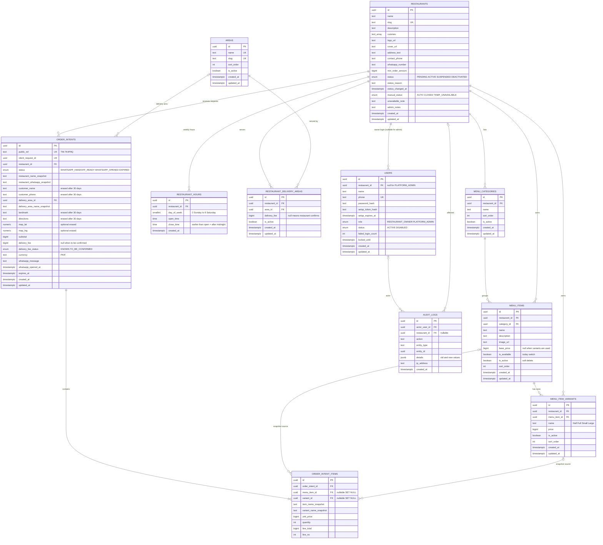

# Dir Food Ordering — Database ERD and Data Dictionary (v1)

PostgreSQL + Prisma. IDs are `uuid`. Money is `bigint` in **paisa** (Rs 450 = 45000), same as Dukaan Pro; the frontend divides by 100 and formats as `Rs 1,100`. Times are `timestamptz` in UTC; opening hours use local time `Asia/Karachi`. No hard deletes for business records: deactivate instead.

## Which candidate tables are kept

| Candidate | Decision | Reason |
|---|---|---|
| `User` | **Keep** | Owner and admin logins. |
| `RestaurantMember` | **Skip in Phase A** | One owner per restaurant, so `users.restaurant_id` is enough. Add the table when staff roles arrive. |
| `Restaurant` | **Keep** | The tenant. |
| `Area` | **Keep** | Shared list of delivery areas, managed by admin. |
| `RestaurantDeliveryArea` | **Keep** | Many-to-many restaurants ↔ areas, with the optional delivery fee. |
| `RestaurantHours` | **Keep** | Weekly opening ranges. |
| `MenuCategory` | **Keep** | Groups items. |
| `MenuItem` | **Keep** | The dishes. |
| `MenuItemVariant` | **Keep (simple)** | Half / Full, Small / Large. Real need in local menus. No add-ons. |
| `OrderIntent` | **Keep** | Recommended Option B. |
| `OrderIntentItem` | **Keep** | Snapshot lines. |
| `AuditLog` | **Keep** | Admin accountability. |
| Customer table | **Not created** | Guest ordering; customer data lives on the intent and is erased after 30 days. |
| Analytics tables | **Not created** | Counts come from `order_intents`. |

## ERD

**Ownership structure:** `restaurants` → one owner `users` row (`restaurant_id`); admins have `restaurant_id = NULL`. Every private table has `restaurant_id` (items and variants carry it directly so a single filter is enough and no join is needed for isolation).

**Reading the relationships:** `||--o{` = one to many, `|o--o{` = optional parent (the child's foreign key may be empty), `||--|{` = one to one-or-many (an intent must have at least one item). Restaurants ↔ areas is many-to-many through `restaurant_delivery_areas`.

## Why each table exists

| Table | Why |
|---|---|
| `restaurants` | The tenant: public profile, WhatsApp number, status, manual availability. |
| `users` | Logins. Phone is the login (same as Dukaan Pro). Admin has no restaurant. |
| `areas` | A shared, admin-controlled list so "Timergara" is spelled the same everywhere and filters work. |
| `restaurant_delivery_areas` | Which areas a restaurant serves, with the optional fee per area. Row kept (deactivated) so old intents can still show the area. |
| `restaurant_hours` | Several ranges per day (lunch + dinner), even after midnight. |
| `menu_categories` | Sections of the menu with order. |
| `menu_items` | Dishes with price, image, availability. |
| `menu_item_variants` | Half / Full style prices. Absolute prices, not deltas. |
| `order_intents` | A server-validated WhatsApp request with snapshots. Not a confirmed order. |
| `order_intent_items` | Snapshot lines so the summary never depends on live menu data. |
| `audit_logs` | Who changed what; required for admin actions. |

## Data dictionary

Legend: **R** required, **N** nullable. All `created_at` default `now()`.

### restaurants
| Column | Type | R/N | Default / constraint |
|---|---|---|---|
| id | uuid | R | PK, `gen_random_uuid()` |
| name | text | R | 2–80 chars |
| slug | text | R | UNIQUE; lowercase letters, digits, single hyphens, 3–60; reserved words blocked (`admin`, `api`, `dashboard`, `login`, `r`, `www`) |
| description | text | N | ≤ 500 |
| cuisines | text[] | R | default `{}`; max 5 |
| logo_url, cover_url | text | N | CHECK starts with `https://` |
| address_text | text | N | |
| contact_phone | text | N | CHECK digits 10–15 |
| whatsapp_number | text | N | CHECK `^[0-9]{10,15}$`; **required before status can become ACTIVE** (service rule) |
| min_order_amount | bigint | N | CHECK ≥ 0 |
| status | enum | R | default `PENDING` |
| status_reason, status_changed_at | text, timestamptz | N | |
| manual_status | enum | R | default `AUTO` |
| unavailable_note | text | N | ≤ 140 |
| admin_notes | text | N | never public |
| created_at, updated_at | timestamptz | R | |

Indexes: `UNIQUE(slug)`, `(status)`, GIN on `cuisines`, `(lower(name))` for search. Soft deletion: `status = DEACTIVATED`.

### users
| Column | Type | R/N | Constraint |
|---|---|---|---|
| id | uuid | R | PK |
| restaurant_id | uuid | N | FK → restaurants, `ON DELETE RESTRICT` |
| name | text | R | |
| phone | text | R | UNIQUE, CHECK digits |
| password_hash | text | N | empty until setup |
| setup_token_hash, setup_expires_at | text, timestamptz | N | one-time link |
| role | enum | R | |
| status | enum | R | default `ACTIVE` |
| failed_login_count | int | R | default 0 |
| locked_until | timestamptz | N | |

Constraints: CHECK `(role = 'PLATFORM_ADMIN' AND restaurant_id IS NULL) OR (role = 'RESTAURANT_OWNER' AND restaurant_id IS NOT NULL)`. Partial unique index `UNIQUE(restaurant_id) WHERE role = 'RESTAURANT_OWNER'` = one owner per restaurant. Deactivation: `status = DISABLED`.

### areas
`id` PK; `name` UNIQUE; `slug` UNIQUE; `sort_order` int default 0; `is_active` default true. Never deleted.

### restaurant_delivery_areas
| Column | Type | Constraint |
|---|---|---|
| id | uuid PK | |
| restaurant_id | uuid FK R | |
| area_id | uuid FK R | |
| delivery_fee | bigint N | CHECK ≥ 0; NULL = "restaurant confirms on WhatsApp"; 0 = free |
| is_active | boolean R | default true |

UNIQUE `(restaurant_id, area_id)`. Index `(area_id, is_active)` for the area filter.

### restaurant_hours
`id`, `restaurant_id` FK, `day_of_week` smallint CHECK 0–6, `open_time` time, `close_time` time, CHECK `open_time <> close_time`. UNIQUE `(restaurant_id, day_of_week, open_time)`. Index `(restaurant_id, day_of_week)`. A day with no rows = closed. These rows are replaced as a set (not soft deleted) because they hold no history.

### menu_categories
`id`, `restaurant_id` FK, `name` (≤ 60), `sort_order` int, `is_active`. UNIQUE `(restaurant_id, lower(name))`. Index `(restaurant_id, sort_order)`.

### menu_items
| Column | Type | R/N | Constraint |
|---|---|---|---|
| id | uuid | R | PK |
| restaurant_id | uuid | R | FK |
| category_id | uuid | R | FK → menu_categories (service checks same restaurant; DB composite FK optional: `UNIQUE(id, restaurant_id)` on categories and FK `(category_id, restaurant_id)`) |
| name | text | R | ≤ 100 |
| description | text | N | ≤ 300 |
| image_url | text | N | https |
| base_price | bigint | N | CHECK ≥ 0. Service rule: required when the item has no active variants |
| is_available | boolean | R | default true (today's switch) |
| is_active | boolean | R | default true (soft delete) |
| sort_order | int | R | default 0 |

Indexes: `(restaurant_id, category_id, sort_order)`, partial `(restaurant_id) WHERE is_active`. UNIQUE `(restaurant_id, category_id, lower(name))`.

### menu_item_variants
`id`, `restaurant_id` FK, `menu_item_id` FK, `name` (≤ 40), `price` bigint CHECK ≥ 0, `is_active`, `sort_order`. UNIQUE `(menu_item_id, lower(name))`. Index `(menu_item_id)`. Price here is the full price of that size.

### order_intents
| Column | Type | R/N | Notes |
|---|---|---|---|
| id | uuid | R | PK |
| public_ref | text | R | UNIQUE, e.g. `TM-7K4P9Q`; CHECK format |
| client_request_id | uuid | R | UNIQUE → duplicate-submission guard |
| restaurant_id | uuid | R | FK, `ON DELETE RESTRICT` |
| status | enum | R | default `WHATSAPP_HANDOFF_READY`; values `WHATSAPP_HANDOFF_READY`, `WHATSAPP_OPENED`, `EXPIRED` |
| restaurant_name_snapshot | text | R | |
| restaurant_whatsapp_snapshot | text | R | number the link opened |
| customer_name | text | N | |
| customer_phone | text | N | CHECK digits |
| delivery_area_id | uuid | N | FK → areas |
| delivery_area_name_snapshot | text | R | |
| landmark | text | N | (required at creation by DTO) |
| directions | text | N | |
| map_lat, map_lng | numeric(9,6) | N | CHECK ranges; both or neither |
| subtotal | bigint | R | CHECK ≥ 0; = sum of line totals |
| delivery_fee | bigint | N | snapshot from area |
| delivery_fee_status | enum | R | `KNOWN` or `TO_BE_CONFIRMED`; CHECK consistency with `delivery_fee` |
| currency | text | R | default `PKR` |
| whatsapp_message | text | N | exact text sent in the link (minimized where possible) |
| whatsapp_opened_at | timestamptz | N | click report, **not** proof of sending |
| expires_at | timestamptz | R | created + 24 h |

Indexes: `UNIQUE(public_ref)`, `UNIQUE(client_request_id)`, `(restaurant_id, created_at DESC)`, `(status, expires_at)`.

### order_intent_items
| Column | Type | Notes |
|---|---|---|
| id | uuid PK | |
| order_intent_id | uuid FK R | `ON DELETE CASCADE` |
| menu_item_id | uuid FK N | `ON DELETE SET NULL`; kept as a link only |
| variant_id | uuid FK N | `ON DELETE SET NULL` |
| item_name_snapshot | text R | |
| variant_name_snapshot | text N | |
| unit_price | bigint R | CHECK ≥ 0, snapshot |
| quantity | int R | CHECK 1–50 |
| line_total | bigint R | CHECK = `unit_price * quantity` |
| line_no | int R | display order; UNIQUE `(order_intent_id, line_no)` |

Index: `(order_intent_id)`, `(menu_item_id)` for popular items.

### audit_logs
`id`, `actor_user_id` FK N, `restaurant_id` FK N, `action` text (e.g. `RESTAURANT_APPROVED`, `RESTAURANT_SUSPENDED`, `SETUP_LINK_CREATED`, `WHATSAPP_NUMBER_CHANGED`, `AREA_CREATED`), `entity_type`, `entity_id`, `details` jsonb, `ip_address`, `created_at`. Append-only (a DB trigger forbids UPDATE and DELETE). Indexes `(restaurant_id, created_at DESC)`, `(actor_user_id, created_at DESC)`.

## Order data integrity

- **Snapshots:** names, variant names, unit price, quantity, line total, subtotal, delivery fee, area name, restaurant name and WhatsApp number are copied at creation. The intent screen and message never read live menu rows.
- **Changed or deactivated items:** the intent is untouched. `menu_item_id` stays as a link but may become `NULL`; the snapshot is the truth.
- **Money:** integer paisa avoids rounding errors (`numeric` would also work; `bigint` keeps it the same as Dukaan Pro). Frontend: `new Intl.NumberFormat('en-PK', { style: 'currency', currency: 'PKR', maximumFractionDigits: 0 }).format(paisa / 100)` → `Rs 1,100`. Show decimals only if a restaurant ever uses paisa.
- **Reference number:** random, short, unambiguous letters and digits; unique index; retry on clash. Not guessable in sequence, so nobody can read other references by counting.
- **Duplicates:** `client_request_id` unique; second call returns the first row.
- **No `CONFIRMED` status:** there is no confirmation workflow in Phase A.

## Prisma notes (no code yet)

- Use `@@map` snake_case table names, `@map` for columns, `@db.Uuid`, `@db.Timestamptz`.
- Enums: `RestaurantStatus`, `ManualStatus`, `UserRole`, `UserStatus`, `OrderIntentStatus`, `DeliveryFeeStatus`.
- CHECK constraints, partial unique indexes and the audit-log trigger go into a raw SQL migration (Prisma cannot express them), the same way `constraints.sql` was used in Dukaan Pro.
- Text arrays and `jsonb` are supported natively by Prisma on PostgreSQL.

**Retention (future work):** Automated personal-data deletion and historical data retention are deferred from the MVP pending a formal retention policy decision and explicit approval. No `personal_data_erased_at` column is proposed for MVP; minimize collection and avoid storing complete WhatsApp messages unnecessarily.
