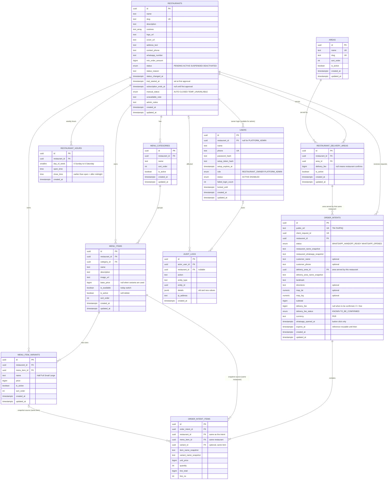

# Dir Food Ordering — Database ERD and Data Dictionary (v1)

PostgreSQL + Prisma. IDs are `uuid` columns holding **UUID v7 values generated by the application** (Prisma `@default(uuid(7))`); there is **no database default** such as `gen_random_uuid()`, and raw-SQL inserts such as seeds must supply a v7 id. Money is `bigint` in **integer paisa** (Rs 450 = 45000), same as Dukaan Pro; the frontend divides by 100 and formats as `Rs 1,100`. Times are `timestamptz` in UTC; opening hours use local time `Asia/Karachi`. Database columns are `snake_case`, Prisma fields `camelCase`. No hard deletes for business records: deactivate instead.

## Which candidate tables are kept

| Candidate | Decision | Reason |
|---|---|---|
| `User` | **Keep** | Owner and admin logins. |
| `RestaurantMember` | **Skip in Phase A** | One owner per restaurant, so `users.restaurant_id` is enough. Add the table when staff roles arrive. |
| `Restaurant` | **Keep** | The tenant. |
| `Area` | **Keep** | Shared list of delivery areas, managed by admin. |
| `RestaurantDeliveryArea` | **Keep** | Many-to-many restaurants ↔ areas, with the optional delivery fee. |
| `RestaurantHours` | **Keep** | Weekly opening ranges. |
| `MenuCategory` | **Keep** | Groups items. |
| `MenuItem` | **Keep** | The dishes. |
| `MenuItemVariant` | **Keep (simple)** | Half / Full, Small / Large. Real need in local menus. No add-ons. |
| `OrderIntent` | **Keep** | Recommended Option B. |
| `OrderIntentItem` | **Keep** | Snapshot lines. |
| `AuditLog` | **Keep** | Admin accountability. |
| Customer table | **Not created** | Guest ordering; the minimal customer fields live on the intent. Retention is deferred (see the retention note at the end). |
| Analytics tables | **Not created** | Counts come from `order_intents`. |
| Subscription / payment tables | **Not created** | Two columns on `restaurants` (`trial_started_at`, `subscription_ends_at`) are enough. No ledger, invoices or price. |

## ERD

**Ownership structure:** `restaurants` → one owner `users` row (`restaurant_id`); admins have `restaurant_id = NULL`. Every private table has `restaurant_id` (items, variants and intent lines carry it directly so a single filter is enough and no join is needed for isolation).

**Tenant isolation in the database (composite foreign keys).** Besides filtering every query by `restaurant_id`, the database itself refuses cross-restaurant links:
- `menu_items (category_id, restaurant_id)` → `menu_categories (id, restaurant_id)`
- `menu_item_variants (menu_item_id, restaurant_id)` → `menu_items (id, restaurant_id)`
- `order_intents (restaurant_id, delivery_area_id)` → `restaurant_delivery_areas (restaurant_id, area_id)` (the area must be one that same restaurant serves)
- `order_intent_items (order_intent_id, restaurant_id)` → `order_intents (id, restaurant_id)`
- `order_intent_items (menu_item_id, restaurant_id)` → `menu_items (id, restaurant_id)`
- `order_intent_items (variant_id, restaurant_id, menu_item_id)` → `menu_item_variants (id, restaurant_id, menu_item_id)` (variant must belong to the stated item)

**Shared areas.** `areas` is global and has no `restaurant_id`; many restaurants may serve the same area through their own `restaurant_delivery_areas` rows. A restaurant cannot reference another restaurant's menu records, but it can freely share an area.

**Reading the relationships:** `||--o{` = one to many, `|o--o{` = optional parent (the child's foreign key may be empty), `||--|{` = one to one-or-many (an intent must have at least one item). Restaurants ↔ areas is many-to-many through `restaurant_delivery_areas`.

## Why each table exists

| Table | Why |
|---|---|
| `restaurants` | The tenant: public profile, WhatsApp number, status, trial / subscription dates, manual availability. |
| `users` | Logins. Phone is the login (same as Dukaan Pro). Admin has no restaurant. |
| `areas` | A shared, admin-controlled list so "Timergara" is spelled the same everywhere and filters work. |
| `restaurant_delivery_areas` | Which areas a restaurant serves, with the optional fee per area. Row kept (deactivated) so old intents can still show the area. |
| `restaurant_hours` | Several ranges per day (lunch + dinner), even after midnight. |
| `menu_categories` | Sections of the menu with order. |
| `menu_items` | Dishes with price, image, availability. |
| `menu_item_variants` | Half / Full style prices. Absolute prices, not deltas. |
| `order_intents` | A server-validated WhatsApp request with snapshots. Not a confirmed order. The complete message is not stored; it is rebuilt from these fields. |
| `order_intent_items` | Snapshot lines so the summary never depends on live menu data. |
| `audit_logs` | Who changed what; required for admin actions. |

## Data dictionary

Legend: **R** required, **N** nullable. All `created_at` default `now()`.

### restaurants
| Column | Type | R/N | Default / constraint |
|---|---|---|---|
| id | uuid | R | PK, UUID v7 generated by the application (no DB default) |
| name | text | R | 2–80 chars |
| slug | text | R | UNIQUE; lowercase letters, digits, single hyphens, 3–60; reserved words blocked (`admin`, `api`, `dashboard`, `login`, `r`, `www`) |
| description | text | N | ≤ 500 |
| cuisines | text[] | R | default `{}`; max 5 |
| logo_url, cover_url | text | N | CHECK starts with `https://` |
| address_text | text | N | |
| contact_phone | text | N | CHECK digits 10–15 |
| whatsapp_number | text | N | CHECK `^[0-9]{10,15}$`; **required before status can become ACTIVE** (service rule) |
| min_order_amount | bigint | N | CHECK ≥ 0 |
| status | enum | R | default `PENDING` |
| status_reason, status_changed_at | text, timestamptz | N | |
| trial_started_at | timestamptz | N | Set once at first approval (`PENDING → ACTIVE`). NULL before |
| subscription_ends_at | timestamptz | N | Set to approval time + 30 days at first approval; later changed only by an admin extension. NULL before. CHECK: both subscription columns NULL together or set together; `>= trial_started_at`; `status = 'ACTIVE'` requires non-NULL |
| manual_status | enum | R | default `AUTO` |
| unavailable_note | text | N | ≤ 140 |
| admin_notes | text | N | never public |
| created_at, updated_at | timestamptz | R | |

Indexes: `UNIQUE(slug)`, `(status, subscription_ends_at)` (eligibility listing), GIN on `cuisines`, `(lower(name))` and `(lower(name) text_pattern_ops)` for prefix search (plain `LIKE 'abc%'` can use a btree only with `text_pattern_ops` under a non-C collation). Plain "contains" search uses `ILIKE '%abc%'` without an index, which is fine for the small MVP table; `pg_trgm` is deliberately not installed. Soft deletion: `status = DEACTIVATED`.

**`DEACTIVATED` is terminal:** a `BEFORE UPDATE` trigger on `restaurants` raises an error if a row with `status = 'DEACTIVATED'` is updated to any other status (safety net behind the service rule).

**Eligibility (computed per request, never stored):** `status = 'ACTIVE' AND subscription_ends_at IS NOT NULL AND subscription_ends_at > now()`. The time-dependent part cannot be a CHECK constraint. No grace period; no expiry job; suspension overrides subscription validity; extending `subscription_ends_at` never changes `status`; dates keep running while suspended. No price, ledger or invoice columns exist.

### users
| Column | Type | R/N | Constraint |
|---|---|---|---|
| id | uuid | R | PK |
| restaurant_id | uuid | N | FK → restaurants, `ON DELETE RESTRICT` |
| name | text | R | |
| phone | text | R | UNIQUE, CHECK digits |
| password_hash | text | N | empty until setup |
| setup_token_hash, setup_expires_at | text, timestamptz | N | one-time link |
| role | enum | R | |
| status | enum | R | default `ACTIVE` |
| failed_login_count | int | R | default 0 |
| locked_until | timestamptz | N | |

Constraints: CHECK `(role = 'PLATFORM_ADMIN' AND restaurant_id IS NULL) OR (role = 'RESTAURANT_OWNER' AND restaurant_id IS NOT NULL)`. Partial unique index `UNIQUE(restaurant_id) WHERE role = 'RESTAURANT_OWNER'` = one owner per restaurant. Deactivation: `status = DISABLED`.

### areas
`id` PK; `name` UNIQUE (case-insensitive, global); `slug` UNIQUE; `sort_order` int default 0; `is_active` default true. Never deleted. Global master list, shared by all restaurants.

### restaurant_delivery_areas
| Column | Type | Constraint |
|---|---|---|
| id | uuid PK | |
| restaurant_id | uuid FK R | |
| area_id | uuid FK R | |
| delivery_fee | bigint N | CHECK ≥ 0; NULL = "restaurant confirms on WhatsApp"; 0 = free |
| is_active | boolean R | default true |

UNIQUE `(restaurant_id, area_id)`. Index `(area_id, is_active)` for the area filter.

### restaurant_hours
`id`, `restaurant_id` FK, `day_of_week` smallint CHECK 0–6, `open_time` time, `close_time` time, CHECK `open_time <> close_time`. UNIQUE `(restaurant_id, day_of_week, open_time)`. Index `(restaurant_id, day_of_week)`. A day with no rows = closed. These rows are replaced as a set (not soft deleted) because they hold no history.

### menu_categories
`id`, `restaurant_id` FK, `name` (≤ 60), `sort_order` int, `is_active`. Also `UNIQUE(id, restaurant_id)` (target of the composite FK). **Uniqueness scope: one restaurant, active rows only**: partial `UNIQUE(restaurant_id, lower(name)) WHERE is_active`. Two restaurants may both have "Karahi"; a deactivated category does not block re-using its name. Index `(restaurant_id, sort_order)`.

### menu_items
| Column | Type | R/N | Constraint |
|---|---|---|---|
| id | uuid | R | PK |
| restaurant_id | uuid | R | FK |
| category_id | uuid | R | Composite FK `(category_id, restaurant_id)` → `menu_categories (id, restaurant_id)`, so a category of another restaurant cannot be used (the service also checks it) |
| name | text | R | ≤ 100 |
| description | text | N | ≤ 300 |
| image_url | text | N | https |
| base_price | bigint | N | CHECK ≥ 0. Service rule: required when the item has no active variants |
| is_available | boolean | R | default true (today's switch) |
| is_active | boolean | R | default true (soft delete) |
| sort_order | int | R | default 0 |

Also `UNIQUE(id, restaurant_id)` (target of composite FKs). Indexes: `(restaurant_id, category_id, sort_order)`, partial `(restaurant_id) WHERE is_active`. **Uniqueness scope: one category, active rows only**: partial `UNIQUE(restaurant_id, category_id, lower(name)) WHERE is_active`. The same dish name may exist in two categories of one restaurant and in different restaurants.

### menu_item_variants
`id`, `restaurant_id` FK, `menu_item_id`, `name` (≤ 40), `price` bigint CHECK ≥ 0, `is_active`, `sort_order`. Composite FK `(menu_item_id, restaurant_id)` → `menu_items (id, restaurant_id)`. Also `UNIQUE(id, restaurant_id, menu_item_id)` (target of the intent-line FK). **Uniqueness scope: one item, active rows only**: partial `UNIQUE(menu_item_id, lower(name)) WHERE is_active` (the restaurant is implied by the composite FK). Index `(menu_item_id)`. Price here is the full price of that size.

### order_intents
| Column | Type | R/N | Notes |
|---|---|---|---|
| id | uuid | R | PK |
| public_ref | text | R | UNIQUE, e.g. `TM-7K4P9Q`; CHECK format |
| client_request_id | uuid | R | UNIQUE → duplicate-submission guard |
| restaurant_id | uuid | R | FK, `ON DELETE RESTRICT` |
| status | enum | R | default `WHATSAPP_HANDOFF_READY`; values `WHATSAPP_HANDOFF_READY`, `WHATSAPP_OPENED`. No `EXPIRED` value: expiry is derived from `expires_at` |
| restaurant_name_snapshot | text | R | |
| restaurant_whatsapp_snapshot | text | R | number the link opened |
| customer_name | text | N | optional; 2–60 when present |
| customer_phone | text | N | optional; CHECK digits 10–15 when present. Not required for rate limiting |
| delivery_area_id | uuid | R | Composite FK `(restaurant_id, delivery_area_id)` → `restaurant_delivery_areas (restaurant_id, area_id)` |
| delivery_area_name_snapshot | text | R | |
| landmark | text | R | 3–150 |
| directions | text | N | ≤ 300 |
| map_lat, map_lng | numeric(9,6) | N | CHECK ranges; both or neither |
| subtotal | bigint | R | CHECK ≥ 0; = sum of line totals |
| delivery_fee | bigint | N | snapshot from area; `0` = free, NULL = to be confirmed |
| delivery_fee_status | enum | R | `KNOWN` or `TO_BE_CONFIRMED`; CHECK consistency with `delivery_fee` |
| currency | text | R | default `PKR` |
| whatsapp_opened_at | timestamptz | N | button-click report, **not** proof of sending. Set exactly when status is `WHATSAPP_OPENED` (CHECK) |
| expires_at | timestamptz | R | created + 24 h. Only limits reuse of the reference; not a deletion date (see Retention) |

**No `whatsapp_message` column.** The message is rebuilt from the snapshot fields above (restaurant name and WhatsApp number, customer name / phone, area name, landmark, directions, optional map pin, item snapshots, subtotal, delivery fee and status, reference). The Google Maps link is included only when `map_lat` and `map_lng` are both present.

Also `UNIQUE(id, restaurant_id)` (target of the line FK). Indexes: `UNIQUE(public_ref)`, `UNIQUE(client_request_id)`, `(restaurant_id, created_at DESC)`, `(restaurant_id, customer_phone, created_at)` (per-phone rate limit; rows without a phone are simply never matched), `(expires_at)`. No `(status, expires_at)` index: there is no job that scans by expiry.

### order_intent_items
| Column | Type | Notes |
|---|---|---|
| id | uuid PK | |
| order_intent_id | uuid R | Composite FK `(order_intent_id, restaurant_id)` → `order_intents (id, restaurant_id)`, `ON DELETE CASCADE` |
| restaurant_id | uuid FK R | same restaurant as the intent |
| menu_item_id | uuid R | Composite FK `(menu_item_id, restaurant_id)` → `menu_items (id, restaurant_id)`, `RESTRICT` (items are deactivated, never hard-deleted) |
| variant_id | uuid N | Composite FK `(variant_id, restaurant_id, menu_item_id)` → `menu_item_variants (id, restaurant_id, menu_item_id)`, `RESTRICT` |
| item_name_snapshot | text R | |
| variant_name_snapshot | text N | |
| unit_price | bigint R | CHECK ≥ 0, snapshot |
| quantity | int R | CHECK 1–50 |
| line_total | bigint R | CHECK = `unit_price * quantity` |
| line_no | int R | display order; UNIQUE `(order_intent_id, line_no)` |

Index: `(order_intent_id)`, `(menu_item_id)` for popular items.

### audit_logs
`id`, `actor_user_id` FK N, `restaurant_id` FK N, `action` text (e.g. `RESTAURANT_APPROVED`, `RESTAURANT_SUSPENDED`, `RESTAURANT_REACTIVATED`, `RESTAURANT_SUBSCRIPTION_EXTENDED`, `SETUP_LINK_CREATED`, `WHATSAPP_NUMBER_CHANGED`, `AREA_CREATED`), `entity_type`, `entity_id`, `details` jsonb, `ip_address`, `created_at`. Append-only (DB triggers forbid UPDATE, DELETE and TRUNCATE). Indexes `(restaurant_id, created_at DESC)`, `(actor_user_id, created_at DESC)`.

## Order data integrity

- **Snapshots:** names, variant names, unit price, quantity, line total, subtotal, delivery fee, area name, restaurant name and WhatsApp number are copied at creation. The intent screen and message never read live menu rows. The message itself is **not stored**; it is rebuilt from these snapshot fields.
- **Changed or deactivated items:** the intent is untouched. The item link stays valid because menu items are only deactivated, never hard-deleted; the snapshot is the truth.
- **Price check:** the request must carry `expectedSubtotal`. On a mismatch with the backend-calculated subtotal the API returns `409 PRICE_CHANGED` and inserts nothing.
- **Expiry:** `expires_at` is evaluated when an intent is read; the row is never rewritten or deleted because of it.
- **Money:** integer paisa avoids rounding errors (`numeric` would also work; `bigint` keeps it the same as Dukaan Pro). Frontend: `new Intl.NumberFormat('en-PK', { style: 'currency', currency: 'PKR', maximumFractionDigits: 0 }).format(paisa / 100)` → `Rs 1,100`. Show decimals only if a restaurant ever uses paisa.
- **Reference number:** random, short, unambiguous letters and digits; unique index; retry on clash. Not guessable in sequence, so nobody can read other references by counting.
- **Duplicates:** `client_request_id` unique; second call returns the first row.
- **No `CONFIRMED` status:** there is no confirmation workflow in Phase A.

## UUID v7 strategy (Prisma records and seeds)

- Prisma-created records: `@default(uuid(7))` is evaluated by Prisma Client in the application, so every `create` / `createMany` gets a v7 id with no DB default.
- Seed scripts must use the Prisma Client (same behaviour) or generate ids with a v7 generator (the `uuid` package's `v7()`) when they use raw SQL. PostgreSQL 16 has no built-in `uuidv7()`, so there is deliberately no database default; raw inserts that omit `id` fail loudly instead of silently producing v4 values.
- Foreign keys reference ids that are already known, so ids never depend on insertion order. v7 is time-ordered, which keeps btree indexes append-friendly.
- `client_request_id` is the one client-generated UUID (idempotency key; any valid UUID).

## Audit-log trigger and test / reset strategy

- `audit_logs` is append-only: `BEFORE UPDATE OR DELETE` row trigger and `BEFORE TRUNCATE` statement trigger raise an exception. Corrections are new rows.
- Because `TRUNCATE` is blocked, **test and local databases are reset by dropping and recreating the schema / database** (`prisma migrate reset` does this), never by truncating tables. Per-test cleanup in integration tests uses a fresh schema or database per run, or restaurant-scoped test data that is never deleted from `audit_logs`.
- The `DEACTIVATED` terminal trigger and the audit triggers are raw-SQL objects that Prisma does not track. Every later migration is generated with `--create-only` and reviewed so Prisma does not emit `DROP` statements for these raw objects (partial / expression indexes, CHECKs, triggers).
- Production never resets; it only runs `prisma migrate deploy`.

## Prisma notes (no code yet)

- Use `@@map` snake_case table names, `@map` for columns, `@db.Uuid`, `@db.Timestamptz`.
- IDs: `@id @default(uuid(7)) @db.Uuid` (application-generated UUID v7).
- Enums: `RestaurantStatus`, `ManualStatus`, `UserRole`, `UserStatus`, `OrderIntentStatus` (`WHATSAPP_HANDOFF_READY`, `WHATSAPP_OPENED`), `DeliveryFeeStatus`.
- Composite foreign keys are declared in Prisma with `@@unique([id, restaurantId])` targets.
- CHECK constraints, partial / expression unique indexes and the audit-log triggers go into a raw SQL migration (Prisma cannot express them), the same way `constraints.sql` was used in Dukaan Pro.
- Text arrays and `jsonb` are supported natively by Prisma on PostgreSQL.

**Retention (deferred):** Automated personal-data deletion and historical-data deletion are deferred from the MVP. The schema has no retention-specific column, job or endpoint. Customer-data collection stays minimal and complete WhatsApp messages are not stored. The retention policy and applicable Pakistani privacy / legal obligations must be reviewed before launch; any deletion feature will be designed and approved separately.
